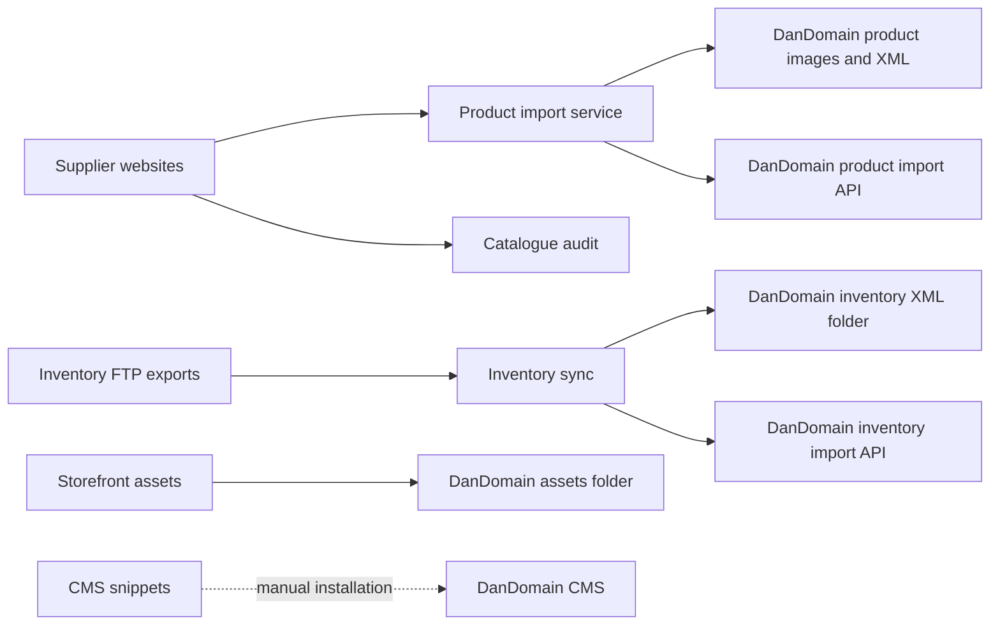

# Repository architecture

This repository is the monorepo for Handicapmidler.dk integrations, storefront assets, CMS snippets, and operational utilities. Production components and tools use the Phase 2 and 3 paths; reference data, CMS content and brand sources await Phase 4.

## System context

## Production components

### Product import

- **Current path:** `services/product-import`
- **Purpose:** Scrape a supplier product page, let an operator review the product, generate DanDomain product XML and image variants, and optionally upload/import them.
- **Runtime:** Python 3.12/FastAPI in Docker Compose; production host is a 64-bit DietPi/Raspberry Pi with private access through Tailscale Serve.
- **Invocation:** Operator-driven web UI. Deployment is a manual Git pull followed by a production Compose rebuild.
- **Inputs:** Supplier URL, operator-edited product fields, category export, environment configuration, and remote supplier images.
- **Outputs:** Persistent files under `data/`, four JPEG variants per enabled image, product XML, FTP uploads to `/images/products/` and `/images/ImportExport/Products/Updated/`, and a DanDomain import request.
- **Secrets:** `AUTH_PASSWORD_HASH`, FTP credentials, and DanDomain API credentials in a server-only `.env` file. Do not commit `.env`.
- **Behavioral boundary:** Dry-run is the default. Enabling upload also requires authentication.

### Inventory synchronization

- **Current path:** `services/inventory-sync`
- **Purpose:** Convert supplier stock and movement exports into DanDomain inventory XML and trigger an update-only import.
- **Runtime:** .NET 8 console application on a GitHub-hosted Ubuntu runner.
- **Invocation:** `.github/workflows/inventory-workflow.yml`, manually or every day at 16:00 UTC.
- **Inputs:** FTP files `VARER.LST`, `LAGERBEHOLD.LST`, and `LAGERBEVAEG.LST`, plus `exclude.txt`.
- **Outputs:** Only `document.xml` is staged in a separate runner-temporary upload directory and sent to `images/ImportExport/Inventory/Updated/`, followed by an update-only DanDomain import request.
- **Secrets:** GitHub Actions secrets `ftp_server`, `ftp_username`, `ftp_password`, `api_upload_endpoint`, `api_username`, and `api_password`.
- **Paths:** Required CLI arguments select the input directory, output XML and exclusion file. Paths are resolved once; providers do not infer repository locations.

### Storefront assets

- **Current path:** `storefront/assets`
- **Purpose:** Maintain the JavaScript and CSS automatically deployed to the webshop.
- **Runtime:** GitHub Actions using `devatherock/minify-js:1.0.3` and `SamKirkland/FTP-Deploy-Action@4.2.0`.
- **Invocation:** A push to `main` changing `storefront/assets/**` or its deployment workflow, or manual workflow dispatch.
- **Inputs:** `storefront/assets/javascripts.js` and `storefront/assets/styles.css`.
- **Outputs:** `javascripts.min.js` and `styles.min.css`, synchronized to the unchanged remote `assets/` destination.
- **Secrets:** GitHub Actions secrets `ftp_server`, `ftp_username`, and `ftp_password`.

## Supported operational tools

### Catalogue audit

- **Current path:** `tools/catalog-audit`
- **Purpose:** Scrape Mobilex catalogue pages and report products missing from a DanDomain product export. This is a catalogue-gap audit, not the single-product import workflow.
- **Runtime/invocation:** Manually executed Python scripts using Selenium, Chrome, pandas, and webdriver-manager.
- **Inputs:** Default or CLI-selected Mobilex category starting URLs and an exported product XML file.
- **Outputs:** Generated Mobilex and missing-product CSV reports.
- **Secrets:** None identified.
- **Paths:** Default outputs and comparison inputs are relative to the tool's ignored `generated/` directory; CLI flags override them. Dependencies are pinned locally.

### Referral reporting

- **Current path:** `tools/reporting/referrals`
- **Purpose:** Aggregate order referrer domains and display a chart.
- **Runtime/invocation:** Manually executed Python script using pandas, matplotlib, and seaborn.
- **Inputs:** Semicolon-delimited `referrals.csv` containing at least `REFERRER`.
- **Outputs:** Interactive bar chart or a CLI-selected image file.
- **Secrets:** None identified, but order exports may contain sensitive production data and must not be committed.
- **Data:** Input is required via `--input`; only synthetic fixtures are tracked. Real exports belong in ignored `private/` storage.

### Manual image preparation

- **Current path:** `tools/image-prep`
- **Purpose:** Manually trim images, convert them to JPEG, and make the four webshop image variants.
- **Runtime/invocation:** Manual Bash script requiring ImageMagick's `magick` command and Caesium CLI's `caesiumclt` command.
- **Inputs:** Explicit input, work and output directory arguments.
- **Outputs:** JPEG variants named `name-p.jpg`, `name.jpg`, `name-r.jpg`, and `name-t.jpg` in the selected output directory.
- **Secrets:** None.
- **Safety:** Only the per-run temporary workspace is deleted; `--keep-work` retains it. Original inputs are preserved. The Pillow implementation in product import is authoritative for automated imports; continued use of this manual tool remains unconfirmed.

## Reference and manually managed content

### CMS snippets

- **Current path:** `static`
- **Target path:** `storefront/cms-snippets/review` until each snippet is verified, then optionally `storefront/cms-snippets/active`.
- **Purpose:** HTML, CSS, and JavaScript manually copied into DanDomain CMS locations.
- **Invocation:** Manual review and installation in DanDomain; no automated deployment exists.
- **Inputs/outputs:** Repository snippets are copied to an as-yet undocumented CMS page, template, or component location.
- **Secrets:** DanDomain administrator access, managed outside this repository.
- **Control:** `docs/CMS-MANIFEST.md` records required content. Retain every listed file and verify its live CMS location before active placement.

### Brand source

- **Current path:** `graphics/handicapmidler.svg`
- **Target path:** `storefront/brand` only if its current use is confirmed.
- **Purpose:** Candidate vector logo/brand source.
- **Status:** Unverified; no automated consumer was identified.

### Reference exports and inventory samples

- **Current paths:** Root `export.xml`, root `export-sample-all-fields.xml`, and `inventory/`.
- **Target paths:** `reference/dandomain` and `reference/inventory`.
- **Purpose:** Examples of DanDomain XML and supplier inventory formats.
- **Control:** Production exports and supplier snapshots must be removed or sanitized before they are retained as fixtures.
